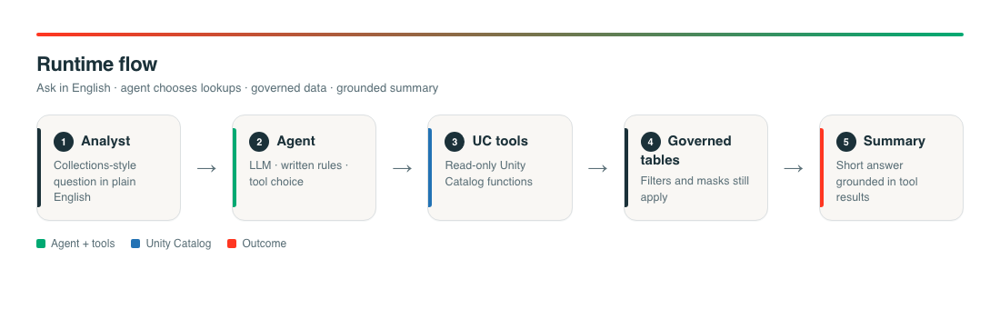
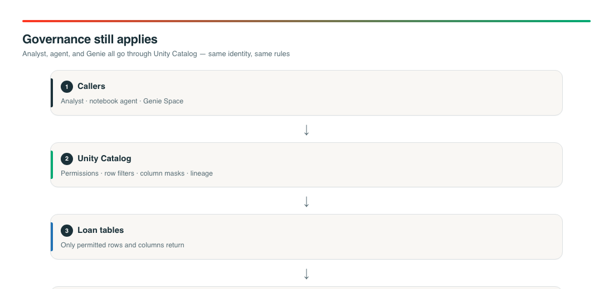
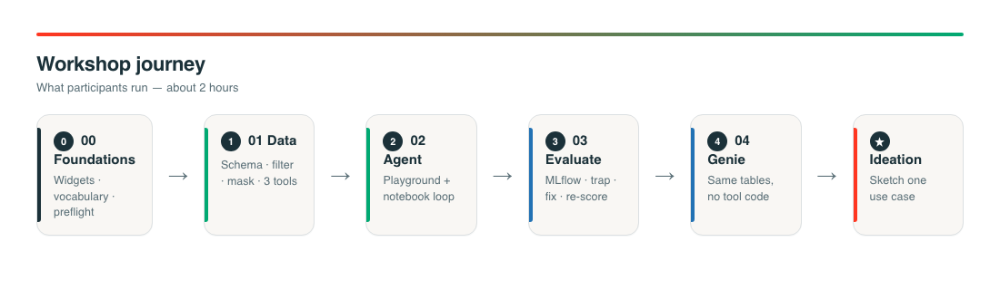
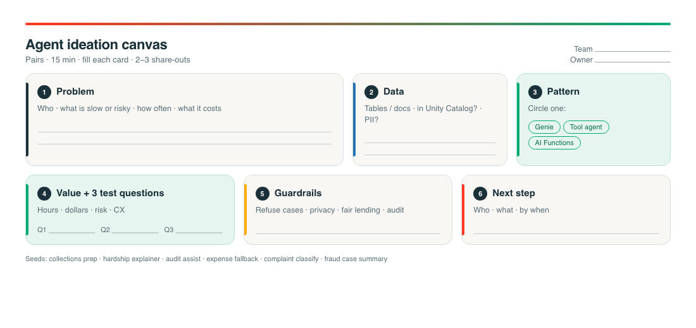

# AI Literacy Workshop: Auto-Loan Servicing Assistant

Hands-on workshop (~2 hours). Participants build a **tool-using agent** over **governed** synthetic auto-loan data, **measure** it with MLflow, **fix** a planted quality bug, optionally try **Genie**, sketch a use case, then see how today's pattern becomes a **real** packaged agent.

This is a tutorial pack for a classroom or self-paced lab. It is not a production servicing application. Lab 5 explains the path from lab to production (no deploy in class).

## Pick your path

| If you are… | Do this |
|---|---|
| **Admin** preparing the workspace once | 1) [ADMIN_CHECKLIST.md](ADMIN_CHECKLIST.md) · 2) notebook [`admin_setup`](src/notebooks/admin_setup.ipynb) · 3) tell participants to open `00_start_here` |
| **Participant** taking the workshop | Open [`00_start_here`](src/notebooks/00_start_here.ipynb) and follow Labs 0–3, optional 4, then **5**. Skip `admin_setup`. |

More install detail: [SETUP.md](SETUP.md).

## Admin path (one-time)

**Goal:** grants and import are done, and one Run All proves the room works.

1. Complete **[ADMIN_CHECKLIST.md](ADMIN_CHECKLIST.md)** (catalog rights, **model access**, warehouse, optional PII group, bring the workshop into the workspace with a **Git folder** or the **zip Import**).
2. Open notebook **`admin_setup`** in the workshop folder.
3. Run the **first code cell (Step 0)**; a widget bar appears at the top of the notebook. Set catalog, **LLM model**, and warehouse to the values participants will use. **Run All**.
4. Confirm: diagram assets are FILE, preflight PASS. Optional: Run All on Lab 1 once.
5. Share the folder path with participants. They start at **`00_start_here`** only.

### Model access (tell participants which string to paste)

Widget name: `llm_endpoint` · label: **LLM model (UC FQN or legacy endpoint)**

| Mode | What to paste | Grants |
|---|---|---|
| **Preferred** | UC model service FQN, e.g. `system.ai.<model>` | `EXECUTE` on the model service (+ `USE CATALOG` / `USE SCHEMA` on `system` / `system.ai`) |
| **Fallback** | Legacy serving endpoint name, e.g. `databricks-meta-llama-3-3-70b-instruct` (workshop default) | `CAN QUERY` on that endpoint |

If preflight says Unity Gateway / model service is unavailable, use the **legacy endpoint name**. That is normal when Gateway is not enabled in the workspace.

## Participant path

**Goal:** build, evaluate, and fix the agent in your own schema; then see the path to a real agent.

1. Open the workshop folder your admin shared.
2. Open **`00_start_here`** (not `admin_setup`).
3. Run the **first code cell (Step 0)**; a widget bar appears at the top of the notebook. Set `catalog`, `schema` (blank = auto), `llm_endpoint` (UC FQN **or** legacy endpoint), `warehouse_name`, then **Run All** through preflight. Your values are saved, so Labs 1 to 5 open with them.
4. Run All on **`01_setup_governed_data`** → **`02_build_agent`** → **`03_evaluate_and_fix`**.
5. Optional: **`04_genie_fallback`**, then fill the ideation canvas image.
6. Run **`05_from_lab_to_real_agent`** (wrap-up: what `_agent_core` is, and what changes next).

Attach **Serverless** (or a UC-enabled cluster). Classroom demo is notebook Run All, not bundle deploy.

## What is in this repo

| Item | Path |
|---|---|
| Admin checklist | [ADMIN_CHECKLIST.md](ADMIN_CHECKLIST.md) |
| Admin setup notebook | [`src/notebooks/admin_setup.ipynb`](src/notebooks/admin_setup.ipynb) |
| Participant labs | `src/notebooks/00_start_here.ipynb` … `05_from_lab_to_real_agent.ipynb` |
| Diagram assets (FILE in workspace) | [`src/notebooks/assets/`](src/notebooks/assets/) |
| README diagrams | [`docs/diagrams/`](docs/diagrams/) |
| Install detail | [SETUP.md](SETUP.md) |
| Optional DAB exhibit | [`databricks.yml`](databricks.yml), [`resources/`](resources/) |

## Use case summary

**Problem.** A collections analyst needs a short, trustworthy answer to questions like: *Show me Texas retail auto loans 30 to 60 days past due with a balance over 15,000 dollars, and summarize the highest-balance one.*

**Approach.** An agent (language model + written rules + read-only lookups) calls Unity Catalog functions. Those functions read governed tables. The agent runs **as you**, so row filters, column masks, and permissions apply. Model access is also a grant: UC model service `EXECUTE` (preferred) or legacy endpoint `CAN QUERY` (fallback).

**Teaching outcome.** You see that free-text notes can disagree with the system of record, you score that failure, and you prove a fix by changing instructions and re-running evaluation.

## How the solution flows (runtime)

  

**Without AI:** the same tables still answer via SQL or a dashboard filter. You lose plain-English routing and multi-step tool choice in one ask.

### Governance still applies

  

Docs: [Unity Catalog](https://learn.microsoft.com/en-us/azure/databricks/data-governance/unity-catalog/) · [Row filters and column masks](https://learn.microsoft.com/en-us/azure/databricks/data-governance/unity-catalog/row-and-column-filters) · [ABAC (at scale)](https://docs.databricks.com/aws/en/data-governance/unity-catalog/abac)

## Notebook map

  

| Order | Notebook | Who | Purpose |
|---|---|---|---|
| A | `admin_setup` | Admin (once) | Prove grants, FILE assets, preflight before class |
| 0 | `00_start_here` | Participant | Widgets, preflight, vocabulary |
| 1 | `01_setup_governed_data` | Participant | Your schema, filter, mask, three UC tools |
| 2 | `02_build_agent` | Participant | AI Playground + notebook agent |
| 3 | `03_evaluate_and_fix` | Participant | MLflow eval, trap, fix, re-score |
| 4 | `04_genie_fallback` | Participant (optional) | Same tables via Genie |
| 5 | `05_from_lab_to_real_agent` | Participant | What `_agent_core` is; path to a packaged agent |

Shared helpers (`%run`): `_config.ipynb`, `_agent_core.ipynb`.

## Ideation canvas

After Lab 4 (or after Lab 3 if you skip Genie), pairs fill this canvas for one use case. Same image shows in Lab 4 via `show_diagram`.

  

## What AI solves here (and what it does not)

| Solves | Does not solve |
|---|---|
| Plain English to the right lookups | Replacing Unity Catalog permissions |
| Multi-step work in one ask | Inventing facts that tools did not return |
| Short narrative from tool results | Beating a fixed daily SQL report when the report never changes |

## References

- [ADMIN_CHECKLIST.md](ADMIN_CHECKLIST.md)
- [SETUP.md](SETUP.md)
- [Unity Catalog overview](https://learn.microsoft.com/en-us/azure/databricks/data-governance/unity-catalog/)
- [Row filters and column masks](https://learn.microsoft.com/en-us/azure/databricks/data-governance/unity-catalog/row-and-column-filters)
- [Unity Catalog Python / SQL UDFs](https://learn.microsoft.com/en-us/azure/databricks/udf/unity-catalog)
- [Migrate to Unity Gateway](https://docs.databricks.com/aws/en/ai-gateway/migrate-to-unity-gateway)
- [AI Playground](https://learn.microsoft.com/en-us/azure/databricks/large-language-models/ai-playground)
- [MLflow GenAI evaluation](https://learn.microsoft.com/en-us/azure/databricks/mlflow3/genai/eval-monitor/)
- [MLflow Tracing](https://learn.microsoft.com/en-us/azure/databricks/mlflow3/genai/tracing/overview)
- [Genie](https://learn.microsoft.com/en-us/azure/databricks/genie/)
- [Notebook widgets](https://learn.microsoft.com/en-us/azure/databricks/notebooks/widgets)
- [Images in notebooks](https://learn.microsoft.com/en-us/azure/databricks/notebooks/notebook-media)
- [Databricks Asset Bundles](https://learn.microsoft.com/en-us/azure/databricks/dev-tools/bundles/)
